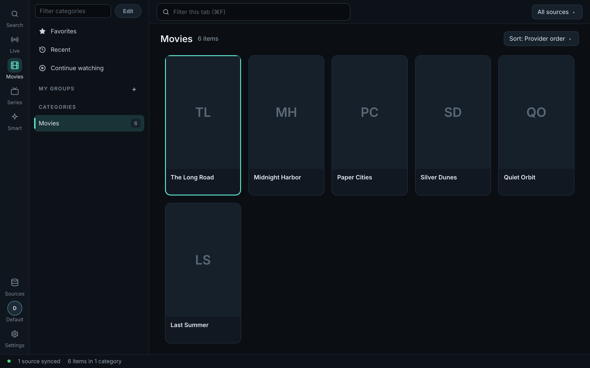
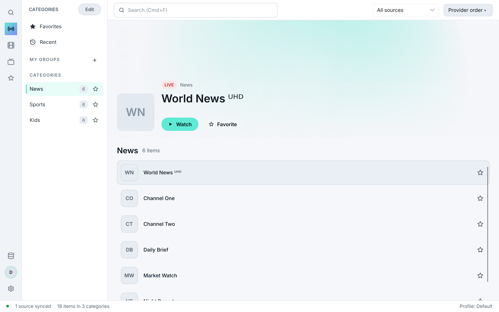
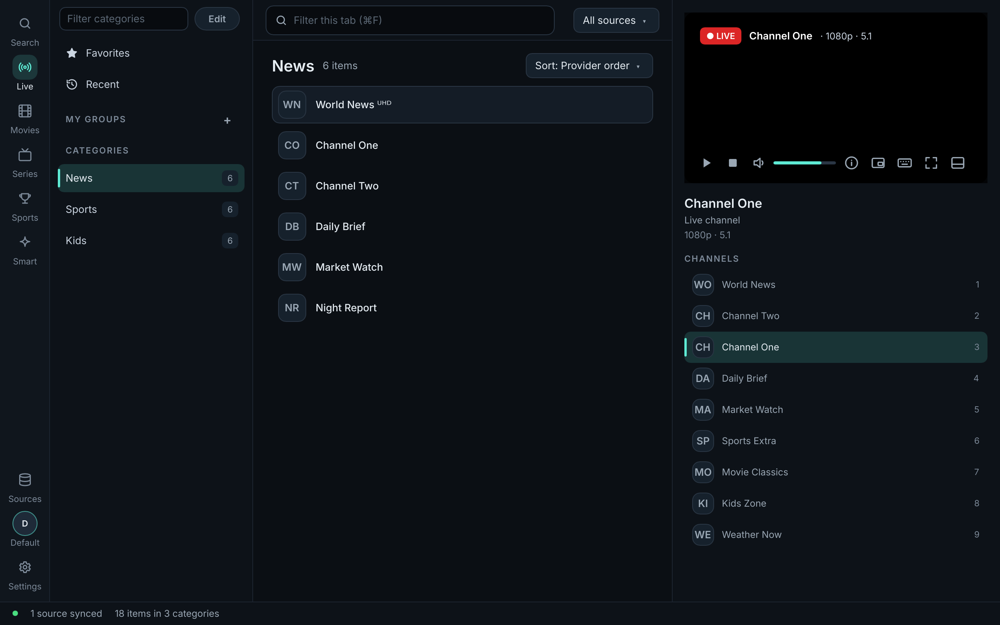

# Parabole

A desktop IPTV player for live television, films and series. Bring your own playlist, keep your library in order, and watch with the built-in player or the player you already use.

Written in Rust with a Slint interface and libmpv playback. For macOS, Windows and Linux.

[Download releases](https://github.com/AnisAbdellatif/parabole/releases) · [Build from source](#build-from-source) · [Keyboard shortcuts](#keyboard-shortcuts) · [Packaging](packaging/README.md)



*Interface snapshot with sample titles. Posters and programme details come from your source when available.*

## Start with your source

Parabole does not supply channels or subscriptions. You need an M3U playlist or an Xtream-compatible account, and permission to access its content.

1. Open **Sources** and add a source.
2. Paste a playlist URL, a local file path, an Xtream `get.php` link, or your server address, username and password. Parabole detects the input and fills the relevant fields.
3. Give the source a name, use **Test** to check it, then save.
4. Choose **Live**, **Movies** or **Series**, open a category, and play an item.

You can keep several sources and browse them together or filter to one. Each source can have a custom user agent; Xtream sources also accept backup server URLs. Refresh sources individually or together, or set a startup refresh interval. Set the interval to `0` to disable automatic refresh.

For Xtream accounts, the source panel can check account status, expiry and active connection counts. Availability and accuracy depend on what the provider reports.

## A library you can arrange

### Live, movies and series

Live channels use a compact list with channel numbers and logos. Movies and series use a poster grid. Series open into seasons and episodes; film and series details can include a synopsis, cast, director, genre, release date, duration and rating.

Metadata is source-dependent. A plain M3U playlist generally supplies names and logos, not the richer details or episode catalogue available through Xtream.

### Search and navigation

Filter the current tab with **Ctrl/Cmd+F**, or open the **Ctrl/Cmd+K** command palette to find content, categories and application actions. Browse with the keyboard as well as the mouse. Lists and grids are virtualized so the interface does not need to draw an entire large catalogue at once.

Sort a category by provider order, channel number or name. Parabole remembers the category’s sort choice.

### Favorites, groups and categories

- **Favorites:** keep a shortlist and arrange its order. Favorites removed by a provider remain visible as unavailable, so you can remove them or wait for them to return.
- **My groups:** create your own collections and add items without changing the provider’s categories.
- **Category editing:** pin frequently used categories, hide others, reorder them, sort alphabetically or reset to provider order. Select a single source to change its category order.
- **Bulk filtering:** hide matching categories or show only those matching a name fragment. You can also make newly discovered categories start hidden.
- **Individual items:** hide unwanted entries and restore them in edit mode. The context menu also offers playback options and stream URL copying.

### Profiles and watch history

Profiles keep separate favorites, category arrangements and watch history. Create, rename, duplicate or delete profiles from the profile dialog. Sources can be reused without setting up each playlist again.

**Recent** brings back previously watched items. **Continue watching** and saved playback positions let you return to unfinished films and episodes. Embedded series playback offers a next-episode countdown with a choice to continue or cancel.

Profiles are library preferences, not password-protected accounts or parental controls.

## TV guide
Live channels can show what is on now and next, with a progress bar on each row and in the player. Open a channel's guide to see its schedule.

- **Provider guides:** the Xtream `xmltv.php` guide or the playlist's `url-tvg` is picked up automatically.
- **More guides:** add XMLTV URLs (plain or gzipped) in **Settings → TV guides**, or add public guides for your playlist's countries in one click. Guides can be enabled, disabled and reordered.
- **Channel matching:** channels are linked to guide entries by guide id, then by name. When the automatic match is wrong, use **Change channel…** in the channel's guide; **Automatic** restores the automatic link.

Guides refresh in the background. Guide coverage and accuracy depend on the guide's publisher.

## Smart tab
The **Smart** tab groups the same channel from all your sources into one entry, best version first. Filter by quality: 4K, Full HD, HD, SD, 50/60 fps or unknown.

Quality comes from playback (recorded a few seconds after the first frame) and from an optional background scanner. The scanner needs `ffprobe` (part of FFmpeg) installed, probes the categories you pick, pauses while you watch, and can be paused or restarted. If a live stream fails, the player can switch to the same channel from another source.

## Sports
The optional **Sports** tab (enable it in **Settings → Sports**) lists football, basketball, tennis, F1, WWE and UFC events by day, with All, Live and Upcoming filters and a search. Select an event to see which TV channels show it, per country, filtered by the languages you choose. Click a channel to copy its name, then find it in your library.

Listings come from free sources (365scores, LiveScore, TheSportsDB) and may be incomplete or change without notice.

## Online details and Trakt
- **Details:** when enabled in settings, film and series pages are completed with poster, rating, plot and cast from IMDb (free, unofficial), with Trakt as a fallback. The titles you open are sent to these services.
- **Trakt:** connect your Trakt account in settings with a device code, then optionally report what you watch: playback progress is scrobbled, and episodes you mark watched are synced. Reports made while offline are queued and sent later.

## Playback

### Built-in player

The default player uses libmpv inside the application. Keep it docked beside or below the library, expand it to fullscreen, or switch to the mini player: a small always-on-top window in the corner of the screen.

Controls include play/pause, stop, mute, volume up to 130%, and seeking for films and episodes. Select audio and subtitle tracks from the stream; Parabole remembers language selections for a stream and restores them when possible. A playback statistics overlay is available for troubleshooting.

For live television:

- Change channels with next/previous shortcuts or enter a channel number.
- Return to the previous channel without finding it in the list again.
- See nearby channels in the channel-switching carousel.
- See how far playback trails the live edge. **Go live** jumps to the end of what is already buffered, without reconnecting; it reconnects only when little is buffered.
- With catch-up enabled, playback skips the backlog a provider sends on connect and speeds up slightly (1.1× or 1.25×) when it falls behind. Set how many seconds behind still count as live in **Settings → Playback**.
- Low-latency buffering can be turned off in settings if a provider's streams stutter.
- Dropped streams retry with backoff, up to a limited retry budget.

Latency, available tracks and playback quality still depend on the stream and provider.

### External players

Choose **mpv**, **VLC** or a custom player instead of embedded playback. Set a default for everything, override it separately for live channels, films and episodes, or choose **Play with** for a single item.

Settings include player detection, explicit executable paths and extra mpv arguments. Custom commands support templates such as:

```text
potplayer {url} /title={title}
```

Commands launch directly, not through a shell. Shell pipelines, redirection and shell expansion are not supported.

If embedded player initialization fails after the application starts, Parabole attempts external mpv and shows a notification. The external player must be installed. This fallback cannot help if the operating system cannot load a required libmpv library at launch.

## Appearance

Choose a dark, light or system-following theme, with six accent palettes. Adjust interface density, text size and corner rounding, or enable reduced motion. Appearance changes apply immediately.

<details>
<summary>Light theme and player controls</summary>





*UI test snapshots with fixture content; these do not demonstrate a connected live stream.*

</details>

## Keyboard shortcuts

Use **Cmd** on macOS and **Ctrl** on Windows and Linux. Playback shortcuts apply while the pointer is over the embedded player, or in fullscreen or mini-player mode, unless noted otherwise. Text fields and dialogs handle their own keys.

| Shortcut | Action |
| --- | --- |
| Ctrl/Cmd+1 … 5 | Live, Movies, Series, Sports, Smart |
| Ctrl/Cmd+K | Open the command palette |
| Ctrl/Cmd+F | Focus the current tab’s search |
| Arrow keys, Page Up / Page Down | Navigate the library |
| Enter | Open or play the selected item |
| Space | Play / pause |
| ← / → | Seek backward / forward 10 seconds |
| ↑ / ↓ | Change volume by 5 |
| M | Mute / unmute |
| F | Toggle fullscreen |
| P | Toggle mini player |
| I | Toggle playback statistics |
| Page Up / Page Down | Previous / next channel in the player |
| Ctrl/Cmd+↑ / ↓ | Previous / next channel during playback, without hovering the player |
| 0–9, then Enter | Switch to a live channel by number |
| L or Backspace | Return to the previous channel during playback |
| Ctrl/Cmd+L | Go live during playback |
| Esc | Leave fullscreen or mini mode; dismiss the active overlay or dialog |

The player’s shortcut help shows the controls relevant to the current content.

## Install

Download a package for your platform from [GitHub Releases](https://github.com/AnisAbdellatif/parabole/releases):

- **macOS:** `.dmg` containing `Parabole.app`.
- **Windows:** `.zip`; extract it and keep the executable with its bundled DLLs.
- **Linux:** `.AppImage`; make it executable, then launch it. Graphics drivers come from your system.

Release packages bundle libmpv and its dependencies. macOS packages may be ad-hoc signed rather than notarized; Gatekeeper can warn on another Mac. Verify the release and its origin before overriding an operating-system warning.

Release builds include `SHA256SUMS` and build-provenance attestations. A Flatpak build recipe is also available, but it is not a published Flathub package. See [packaging instructions](packaging/README.md) for details.

## Build from source

Install a current stable [Rust toolchain](https://rustup.rs/) and the native dependencies below. The default build includes the Slint UI and embedded libmpv player.

### macOS

```sh
brew install mpv
cargo run --release
```

The build searches `/opt/homebrew/lib` and `/usr/local/lib` for libmpv. Install `ffmpeg` too (`brew install ffmpeg`) if you want the Smart tab's quality scanner.

### Linux

On Ubuntu / Debian:

```sh
sudo apt-get install libmpv-dev libgl1-mesa-dev libx11-dev libxcursor-dev \
  libxrandr-dev libxi-dev libxkbcommon-dev libxkbcommon-x11-dev \
  libwayland-dev libegl1-mesa-dev libgtk-3-dev libxcb-render0-dev \
  libxcb-shape0-dev libxcb-xfixes0-dev
cargo run --release
```

Package names vary by distribution.

### Windows

Use Rust’s MSVC toolchain and a Visual Studio developer shell. The bundled setup script requires `7z` and the Visual Studio `lib.exe` tool:

```powershell
./packaging/windows-mpv.ps1
cargo run --release
```

The script downloads a libmpv development build and prepares its import library. For a distributable archive with the runtime DLL, use [the Windows packaging script](packaging/README.md#windows-zip).

### Library-only build

```sh
cargo build --no-default-features
cargo test --no-default-features
```

This excludes both Slint and libmpv. It builds the library and tests, not a desktop application or a separate CLI player.

## Local data and credentials

Parabole stores its library and preferences locally, using SQLite in the operating system’s application-data directory. Logos and posters are cached on disk. There is no cloud-sync feature.

Treat the application-data directory as sensitive: source configuration contains provider credentials, and a connected Trakt account's tokens are stored there too. Profiles are not a security boundary. Copied stream URLs can also contain usernames and passwords; do not paste them into public issues, logs or screenshots. Playback, refreshes and artwork loading contact the servers named by your sources. Other services are contacted only for the features that use them: guide URLs you add, IMDb and Trakt for online details, Trakt for scrobbling, and 365scores, LiveScore and TheSportsDB for the Sports tab.

## Current limits

Parabole is at version `0.2.0`. It does not currently provide catch-up TV or replay browsing, recording, parental PINs or cloud synchronization. Live-edge catch-up adjusts playback toward the current broadcast; it is not a provider’s replay or archive service.

## Development

Network and database work runs on a background worker; the UI sends commands and receives events. Source parsing, SQLite storage and player launching are separate modules. See [project conventions](CLAUDE.md) and [Slint implementation notes](docs/slint-experiment.md) for the development details.

Before submitting a change, run:

```sh
cargo fmt
cargo clippy --all-targets -- -D warnings
cargo test
cargo clippy --all-targets --no-default-features -- -D warnings
cargo test --no-default-features
```

Tests cover source parsing, database behavior, player logic and the Slint UI, including headless interaction tests and visual snapshots. Use fixture data in bug reports rather than sharing a working subscription or private playlist.
